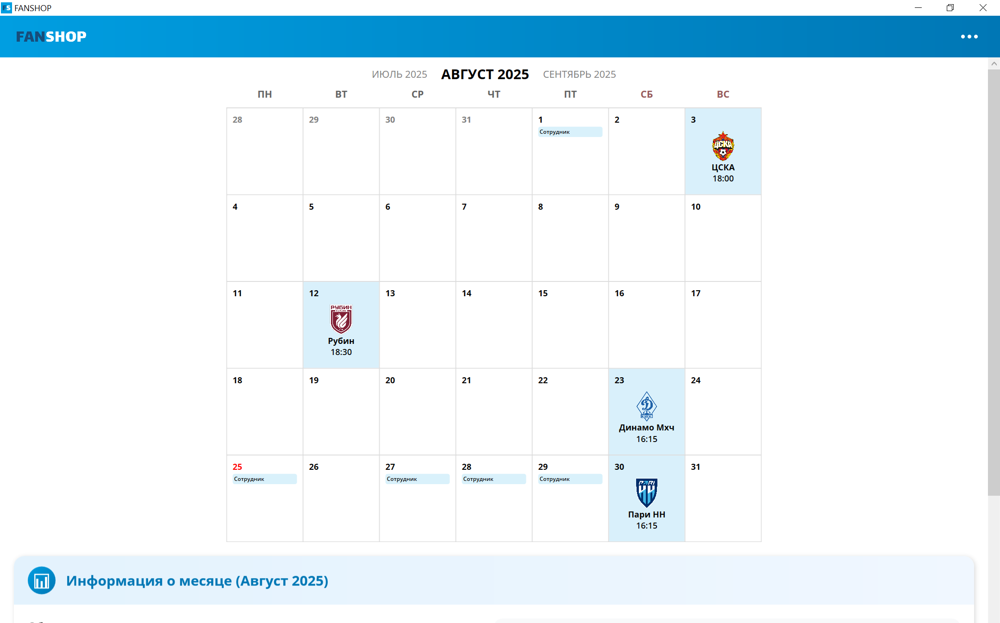
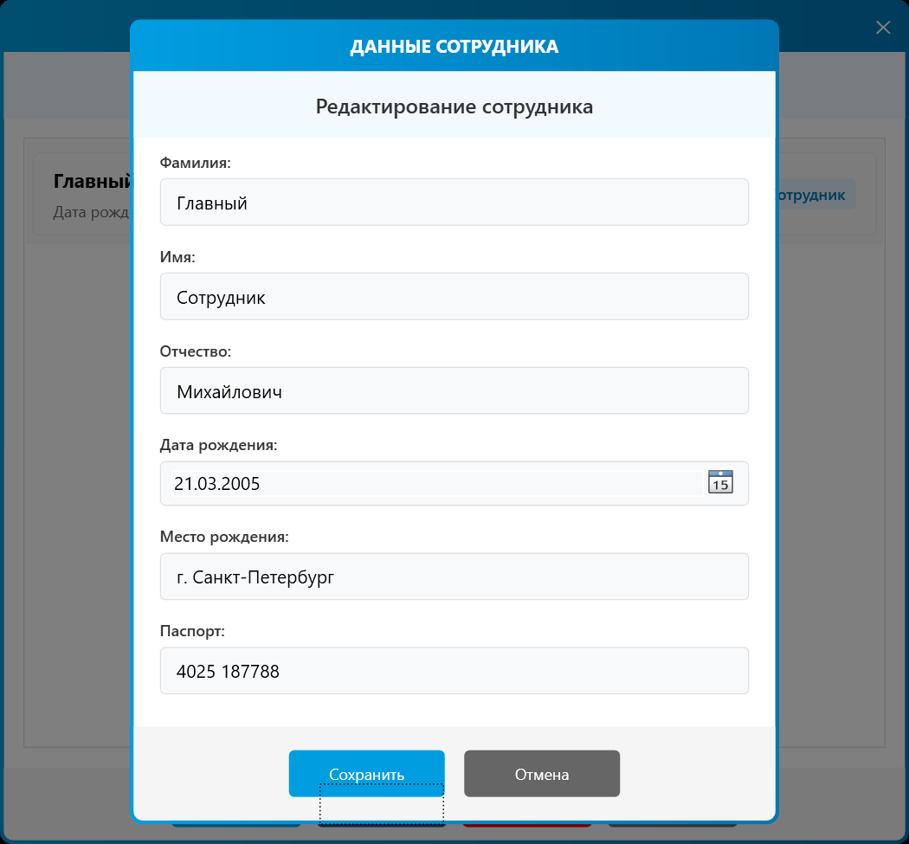
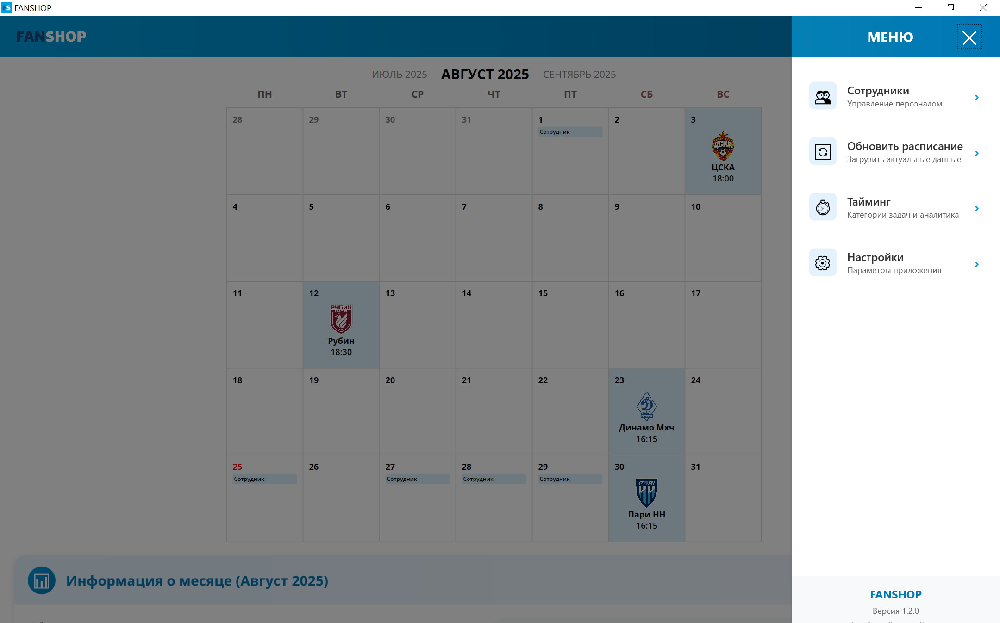
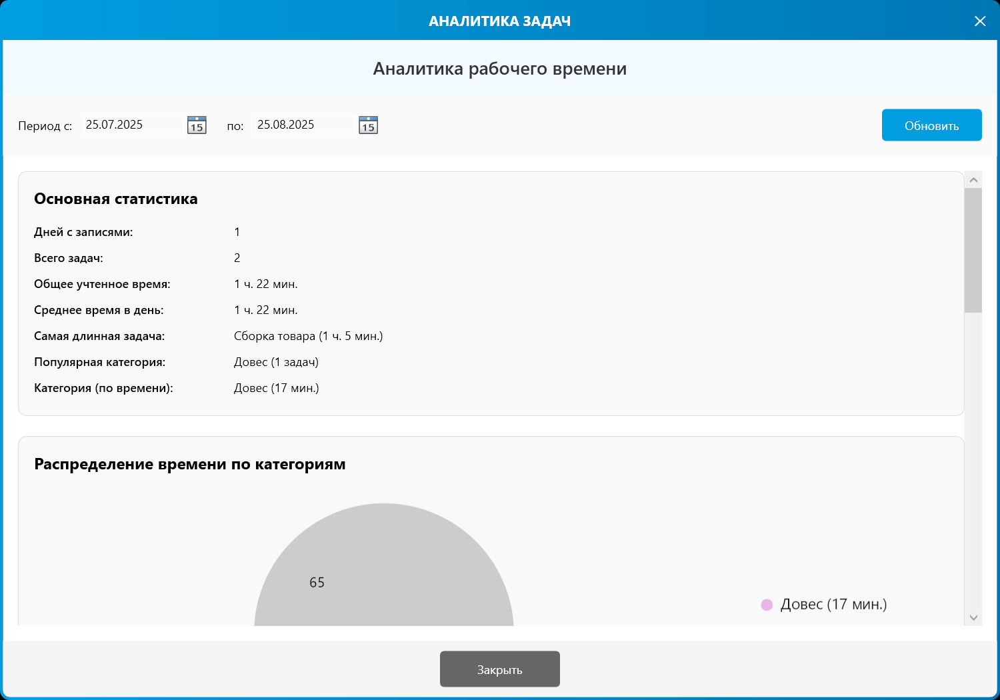
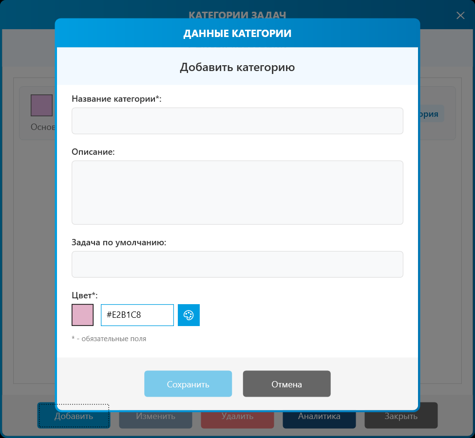

# FanShop — Avalonia Application for Matchday and Shop Management

**FanShop Calendar** is a desktop application built with **C#/.NET 10 and Avalonia** for managing the day-to-day operations of the **Zenit Football Club's FanShop**. It provides tools for scheduling matches, assigning employee shifts, calculating payroll, printing access passes and price tags, and analyzing sales report adjustments.

---

## Features

- 📅 **Matchday Calendar**
  - Displays upcoming Zenit FC matches, employee shifts, and tasks
  - Supports month/year navigation and filtering employees by shop
  - Clearly distinguishes neighboring-month days, including their matches, employees, and tasks

- 👥 **Employee Shift Management**
  - Manages employees, shops, positions, and full-day or half-day shifts
  - Assigns one employee to several dates in a single operation
  - Supports default shops and positions, with editable shift details

- 💵 **Payroll Calculation**
  - Calculates salaries using shift assignments and position salary history
  - Lets individual shifts be included in or excluded from payroll
  - Provides employee, shop, and position breakdowns with Excel export

- 🖨️ **Pass Printing**
  - Generates Word (DOCX) access passes for selected employees
  - Creates a combined pass for multiple selected dates
  - Supports a customizable document template and per-shift inclusion settings

- 🏷️ **1C Price Tags**
  - Imports an XLSX product catalog with barcodes, articles, names, and characteristics
  - Receives scans from a browser on another computer or imports TXT files
  - Groups repeated scans, identifies unknown barcodes, and supports undo
  - Transfers verified positions to a local 1C price-tag form on Windows
  - Supports pause, stop, adjustable delays, and recovery of unfinished sessions

- 🧮 **Sales Report Adjustment**
  - Imports XLSX sales reports and accepts an adjustment amount or several corrective positions
  - Finds permitted discount changes that preserve the control total exactly to the kopeck
  - Accounts for quantities, rounding rules, existing discounts, services, and MISC items
  - Supports protected rows, explicitly permitted exclusions, ranked solutions, and cancellation
  - Shows before/after previews and copies instructions for manual processing in 1C
  - Reads the original report without editing it or automating 1C actions

- ⚙️ **Flexible Settings**
  - Configures shops, positions, salary rates, and document templates
  - Saves price-tag connection settings and transfer delays
  - Configures allowed discounts, their priorities, service names, and report rounding rules

- 📊 **Analytics and Reporting**
  - Shows shift counts, payroll totals, and task timing statistics
  - Provides breakdowns by employee, match, shop, and position
  - Exports reports to Excel and includes in-app FAQ and release notes

- 🔄 **Automatic Updates and EXE Installer**
  - Publishes a versioned Windows EXE installer and an auto-update ZIP through GitHub Actions
  - Includes the .NET and ASP.NET Core runtime in Windows releases
  - Verifies update checksums, backs up affected files, and confirms the new application starts
  - Restores the previous version after a failed update and supports interrupted-update recovery
  - Removes known obsolete components while preserving user data and unknown or modified files

---

## UI Preview

The screenshots below show the main application sections. Newer releases also include price tags, sales report adjustment, and updated calendar styling.











---

## Installation

### Windows Installer

1. Open the [GitHub Releases](https://github.com/kihort-si/FanShop/releases) page.
2. Download `FanShopSetup-<version>.exe` from the desired release's **Assets**.
3. Run the installer, select the installation directory and shortcuts, and finish the wizard.
4. Launch FanShop from the Start menu or desktop shortcut.

The default installation directory is `%LOCALAPPDATA%\Programs\FanShop`. The installer includes the runtime, so installing the .NET SDK separately is not required. Versioned EXE installers are generated for new releases by CI; older releases may only provide a ZIP.

Windows x64 is the primary deployment target. Keyboard transfer to 1C requires a locally installed Windows 1C client. The interface and local analysis tools can also be built on macOS/Linux; 1C keyboard automation is Windows-only.

### Build from Source

1. Install the [.NET 10 SDK](https://dotnet.microsoft.com/en-us/download/dotnet/10.0) compatible with `global.json`.
2. Clone the repository:

   ```bash
   git clone https://github.com/kihort-si/FanShop.git
   cd FanShop
   ```

3. Restore dependencies, build, and run:

   ```bash
   dotnet restore FanShop.sln
   dotnet build FanShop.sln -c Release
   dotnet run --project FanShop.csproj
   ```

4. Open `FanShop.sln` in JetBrains Rider or another IDE with .NET 10 and Avalonia support.

Run the test suite with:

```bash
dotnet test FanShop.sln -c Release
```

To open a module directly:

```bash
dotnet run --project FanShop.csproj -- --price-tags
dotnet run --project FanShop.csproj -- --report-adjustment
```

## Dependencies

- **.NET 10** — application platform
- **Avalonia** — desktop UI, Fluent theme, and data grids
- **CommunityToolkit.Mvvm** — view models, observable properties, and commands
- **Entity Framework Core and SQLite** — local employee, shift, and task data
- **OpenXML SDK** — Word document generation
- **ClosedXML and EPPlus** — Excel import and reporting
- **Firebase REST API** — match schedule synchronization
- **LiveCharts2 and SkiaSharp** — charts and graphics
- **ASP.NET Core/Kestrel** — local barcode scanning endpoint
- **xUnit and Avalonia.Headless** — business logic, HTTP, and UI tests
- **Inno Setup** — Windows EXE installer generation in CI

## Project Structure

```plaintext
FanShop/
├── Models/                  # Employees, shifts, matches, settings, and tasks
├── ViewModels/              # MVVM state, commands, and module workflows
├── View/                    # Avalonia controls and AXAML views
├── Windows/                 # Windows and dialogs
├── Converters/              # Data-binding converters
├── Services/                # Documents, statistics, module DI, and updates
├── PriceTags/
│   ├── Core/                # Price tags, report adjustment, and update logic
│   ├── Tests/               # Unit, HTTP, update, and headless UI tests
│   └── Samples/             # Example XLSX catalogs/reports and TXT scans
├── Resources/               # Icons, fonts, and application assets
├── installer/               # Inno Setup installer definition
├── scripts/                 # Windows packaging and installation checks
├── docs/                    # Deployment and auto-update documentation
├── .github/workflows/       # CI and release publication
├── FanShop.csproj           # Main Avalonia application project
├── FanShop.sln              # Application, core library, and test solution
├── MainWindow.axaml         # Main application window
└── App.axaml                # Application resources and styles
```

## License

This project is licensed under the [MIT License](LICENSE).

## Acknowledgements

- To Zenit FC for the inspiration
- To the development team for their effort
- To users for feedback and support

## Feedback & Issues

Found a bug? Have an idea? Open an [issue](https://github.com/kihort-si/FanShop/issues) or submit a pull request. See the [contributing guidelines](CONTRIBUTING.md) for details.

⚽ Built with a love for football and clean desktop apps.
